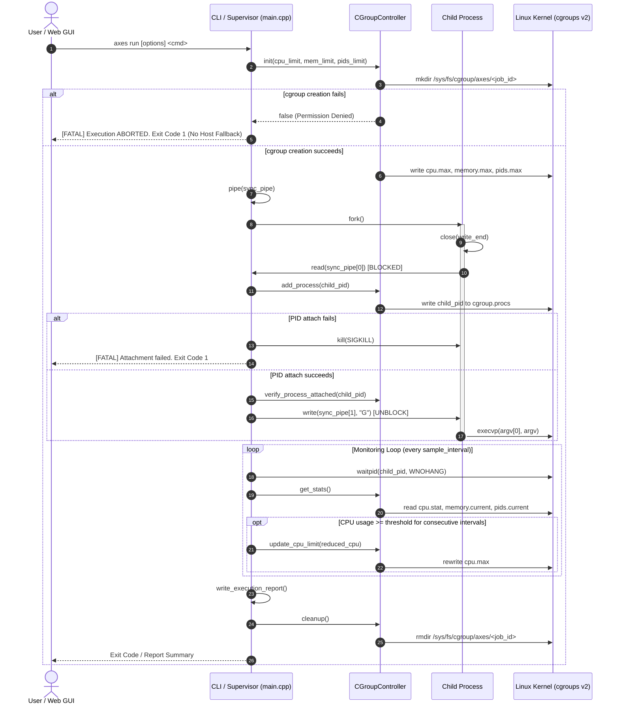

# AXES — Comprehensive Repository Audit & Implementation Status Report

## 1. Executive Summary

An exhaustive, evidence-based architectural, runtime, and security audit of **AXES (Adaptive eXecution Environment Sandbox)** was conducted on **October 21, 2026**.

AXES is currently an early-to-mid stage prototype (~45% overall completion towards the target developer workbench). The repository provides a working C++17 execution supervisor that interfaces directly with **Linux cgroups v2**, an initial automated test suite, sample workloads, and a local dark-themed web dashboard powered by a lightweight Python HTTP server.

### Key Audit Findings

1. **Strict Non-Fallback Guarantee (Verified Working):**
   The core C++ supervisor strictly fulfills the mandate that untrusted workloads must never execute uncontained on the host if sandbox creation fails. Verification confirmed that running `./build/axes run` without cgroup permissions immediately halts execution before `fork()` or child unblocking, leaving the target command unexecuted.
2. **Resource Containment vs. Security Isolation:**
   While Linux cgroups v2 resource ceilings (`cpu.max`, `memory.max`, `memory.swap.max = 0`, `pids.max`) are implemented, **security isolation is completely absent**. AXES implements **no Linux namespaces** (`CLONE_NEWPID`, `CLONE_NEWNS`, `CLONE_NEWNET`), **no Seccomp-BPF syscall filters**, **no filesystem chroot/jail**, and **no network sandboxing**. Untrusted workloads execute with standard host user privileges and full filesystem/network access.
3. **Execution Gaps in Core Runtime:**
   The C++ engine lacks **execution timeouts** (runaway workloads run forever), captures **no child stdout/stderr** (output is discarded or leaked to the supervisor's tty), provides **no supervisor signal handling** (orphaning cgroups on `SIGINT`/`SIGTERM`), and migrates surviving child processes to the parent cgroup upon cleanup instead of killing them.
4. **Reliability and Validation Vulnerabilities:**
   CLI argument parsing crashes with unhandled exceptions on invalid numbers (`std::invalid_argument` via `std::stod`). `job_id` parameters lack path-sanitization across both C++ and Python, permitting directory traversal.
5. **GUI Workbench Status:**
   The web interface is an interactive demo dashboard rather than a professional developer workbench. It connects to the runtime and renders live telemetry, but lacks file drag-and-drop, workspace staging, language detection, job cancellation/stop controls, and terminal output streaming. Furthermore, the web server exposes an unrestricted `POST /api/run` endpoint with wildcard CORS (`Access-Control-Allow-Origin: *`), introducing a remote code execution vector from local browser sessions.

---

## 2. Repository and Environment

### Repository State

| Attribute | Observed Value |
| :--- | :--- |
| **Git Branch** | `main` |
| **Commit Hash** | `3279c6b8c2a9285119bb7c297f6f47e85dfff5f9` |
| **Working Tree** | Clean (nothing to commit) |
| **Repository Size** | 22 tracked source/script/config files |

### Top-Level Directory Inventory

```text
c:\Users\anuro\Desktop\AXES/
├── CMakeLists.txt              # CMake build configuration (C++17, pthread)
├── README.md                   # System documentation & architectural summary
├── .gitignore                  # Git ignore rules for build & temp files
├── build/                      # Pre-existing CMake build artifacts and ELF binaries
├── reports/                    # Execution report output directory (contains job-cpu-review_report.txt)
├── scripts/
│   └── setup_cgroups.sh        # Privileged bash script for root cgroup delegation
├── src/
│   ├── main.cpp                # CLI entry point, argument parser, environment check
│   ├── launcher.hpp            # Process execution launcher & supervisor definitions
│   ├── launcher.cpp            # Process launch, sync pipe, monitoring loop, report writer
│   ├── cgroup.hpp              # cgroups v2 controller interface definitions
│   ├── cgroup.cpp              # cgroups v2 directory management and sysfs I/O
│   ├── monitor.hpp             # Resource tracking monitor definitions
│   └── monitor.cpp             # Periodic metric sampling and procfs fallback
├── tests/
│   ├── test_suite.cpp          # C++ unit test suite
│   └── run_tests.sh            # End-to-end automated verification runner
├── web/
│   ├── server.py               # Embedded Python REST API server (127.0.0.1:8080)
│   ├── index.html              # Dashboard HTML structure
│   ├── style.css               # Dark theme stylesheet
│   └── app.js                  # Frontend telemetry polling & canvas charts
└── workloads/
    ├── cpu_burn.py             # Multi-process sustained CPU burn workload
    ├── memory_stress.py        # Gradual memory allocation stress workload
    ├── process_stress.c        # Fork bomb process creation stress workload
    └── normal_workload.py      # Finite mathematical computation workload
```

### Key Component Responsibilities

- [`src/cgroup.cpp`](file:///c:/Users/anuro/Desktop/AXES/src/cgroup.cpp) / [`src/cgroup.hpp`](file:///c:/Users/anuro/Desktop/AXES/src/cgroup.hpp): Manages cgroup directory lifecycle under `/sys/fs/cgroup/axes/<job_id>`, writes resource limits (`cpu.max`, `memory.max`, `memory.swap.max`, `pids.max`), attaches PIDs, and reads accounting statistics.
- [`src/launcher.cpp`](file:///c:/Users/anuro/Desktop/AXES/src/launcher.cpp) / [`src/launcher.hpp`](file:///c:/Users/anuro/Desktop/AXES/src/launcher.hpp): Coordinates child process execution via `fork()`/`execvp()`, parent-child pipe barrier synchronization, sampling loop, dynamic adaptive throttling evaluation, and report file generation.
- [`src/monitor.cpp`](file:///c:/Users/anuro/Desktop/AXES/src/monitor.cpp) / [`src/monitor.hpp`](file:///c:/Users/anuro/Desktop/AXES/src/monitor.hpp): Samples metric deltas (CPU %, Memory MB, PID count) and falls back to `/proc/<pid>/status` if sysfs is unreadable.
- [`src/main.cpp`](file:///c:/Users/anuro/Desktop/AXES/src/main.cpp): CLI argument parsing for `axes check` and `axes run`.
- [`web/server.py`](file:///c:/Users/anuro/Desktop/AXES/web/server.py): Spawns the supervisor as a subprocess, parses stdout logs, and exposes REST endpoints (`/api/status`, `/api/run`, `/api/job/<id>`, `/api/history`, `/api/report/<id>`).
- [`scripts/setup_cgroups.sh`](file:///c:/Users/anuro/Desktop/AXES/scripts/setup_cgroups.sh): Root setup script enabling controller delegation (`+cpu +memory +pids`) to an unprivileged user.

### Execution Environment Audit

Verification was performed against the host's active execution environment:
- **Host OS:** Windows 11 with WSL2 (`Linux ANUROOP-LEGION 6.18.33.2-microsoft-standard-WSL2 #1 SMP PREEMPT_DYNAMIC Thu Jun 18 21:54:43 UTC 2026 x86_64`).
- **Toolchain:** CMake 4.2.3, GCC/G++ 15.2.0 (Ubuntu 15.2.0-16ubuntu1), Python 3.14.4.
- **Cgroups Hierarchy:** cgroups v2 mounted as `cgroup2fs` at `/sys/fs/cgroup`. Root controllers available: `cpuset cpu io memory hugetlb pids rdma`.
- **User State:** User `anuroop` (uid=1000). `/sys/fs/cgroup/axes` does not exist by default, and unprivileged creation in root `/sys/fs/cgroup` fails with `EACCES` unless delegated via `scripts/setup_cgroups.sh`.

---

## 3. Architecture and Data Flow

### Supervision & Execution Flow



### Data Flow & Boundary Analysis

1. **Parameters & Configuration:** CLI inputs or JSON payloads from [`web/server.py`](file:///c:/Users/anuro/Desktop/AXES/web/server.py) configure [`axes::Config`](file:///c:/Users/anuro/Desktop/AXES/src/launcher.hpp#L13-L32).
2. **Kernel Enforcement Boundary:** Initial limits are committed to `/sys/fs/cgroup/axes/<job_id>/` before child execution.
3. **Telemetry Pipeline:** [`axes::Monitor::sample`](file:///c:/Users/anuro/Desktop/AXES/src/monitor.cpp#L20-L57) reads sysfs files. In CLI mode, metrics are dumped to `stdout`. In Web mode, [`web/server.py`](file:///c:/Users/anuro/Desktop/AXES/web/server.py#L185-L240) parses stdout regex patterns from the C++ supervisor and buffers them into an in-memory dictionary polled by [`web/app.js`](file:///c:/Users/anuro/Desktop/AXES/web/app.js#L155-L218).
4. **Report Generation:** Upon process exit, [`axes::ExecutionLauncher::write_execution_report`](file:///c:/Users/anuro/Desktop/AXES/src/launcher.cpp#L44-L109) writes an ASCII text report in `reports/<job_id>_report.txt`.

---

## 4. Core Runtime Audit

### 1. CLI Argument Parsing and Validation
- **Relevant Files:** [`src/main.cpp`](file:///c:/Users/anuro/Desktop/AXES/src/main.cpp#L66-L149)
- **Status:** **BROKEN**
- **Findings & Reliability Issues:**
  - Argument values are parsed using standard library conversion routines without exception handling:
    - `std::stod` ([`main.cpp:105`](file:///c:/Users/anuro/Desktop/AXES/src/main.cpp#L105))
    - `std::stoull` ([`main.cpp:107`](file:///c:/Users/anuro/Desktop/AXES/src/main.cpp#L107))
    - `std::stoll` ([`main.cpp:109`](file:///c:/Users/anuro/Desktop/AXES/src/main.cpp#L109))
    - `std::stoi` ([`main.cpp:113`](file:///c:/Users/anuro/Desktop/AXES/src/main.cpp#L113))
  - **Verified Crash:** Running `./build/axes run --cpu-limit not_a_number echo hello` immediately aborts:
    ```text
    terminate called after throwing an instance of 'std::invalid_argument'
      what():  stod
    ```
  - **Integer Underflow:** Passing negative memory limits (e.g. `--memory-limit -1`) causes `std::stoull` to silently wrap to `18446744073709551615`. Multiplying by `1024 * 1024` causes an unsigned integer overflow before writing to `memory.max`.
  - **Argument Boundary Drift:** If an option is provided without a value at the end of the option list (e.g., `./build/axes run --cpu-limit`), the check `i + 1 < argc` evaluates to false, falling through into either an "unknown option" error or treating the flag as the target binary command.

### 2. Process Creation and Execution
- **Relevant Files:** [`src/launcher.cpp`](file:///c:/Users/anuro/Desktop/AXES/src/launcher.cpp#L164-L196)
- **Status:** **IMPLEMENTED, NOT VERIFIED** (Unit execution verified, full multi-process cgroup execution blocked by environment delegation)
- **Findings:**
  - Standard POSIX `fork()` followed by `execvp()`.
  - Argument vector `argv` is constructed properly as null-terminated pointers.
  - If `execvp()` fails, the child outputs to `std::cerr` and exits cleanly via `_exit(127)`.

### 3. Parent-Child Synchronization During Launch
- **Relevant Files:** [`src/launcher.cpp`](file:///c:/Users/anuro/Desktop/AXES/src/launcher.cpp#L156-L184), [`src/launcher.cpp`](file:///c:/Users/anuro/Desktop/AXES/src/launcher.cpp#L219-L222)
- **Status:** **VERIFIED WORKING**
- **Findings:**
  - A unidirectional pipe barrier `sync_pipe[2]` synchronizes parent and child.
  - The child immediately closes the write end and performs a blocking single-byte `read(sync_pipe[0], &buf, 1)`.
  - The child is physically incapable of invoking `execvp()` until the parent writes `"G"` into the pipe.
  - If parent cgroup initialization or PID attachment fails, the parent does not write to the pipe, kills the child with `SIGKILL`, and closes the descriptors. The workload never runs uncontained.

### 4. Cgroup Creation, Configuration, and Cleanup
- **Relevant Files:** [`src/cgroup.cpp`](file:///c:/Users/anuro/Desktop/AXES/src/cgroup.cpp#L57-L160), [`src/cgroup.cpp`](file:///c:/Users/anuro/Desktop/AXES/src/cgroup.cpp#L255-L280)
- **Status:** **PARTIALLY IMPLEMENTED**
- **Findings & Reliability Issues:**
  - Creates `/sys/fs/cgroup/axes/<job_id>`.
  - Writes controllers into `cgroup.subtree_control`.
  - **Cleanup Flaw (Process Leakage):** During [`axes::CGroupController::cleanup()`](file:///c:/Users/anuro/Desktop/AXES/src/cgroup.cpp#L255-L280), if processes remain in the cgroup (e.g. background worker threads or child forks), it attempts to read `cgroup.procs` and write each PID into the parent cgroup `/sys/fs/cgroup/axes/cgroup.procs`. **It does not terminate the processes.** If the workload spawned background processes, they are migrated to the unthrottled parent cgroup and continue running on the host system.
  - **Directory Removal Failure:** In cgroups v2, a cgroup cannot be removed with `rmdir()` if it contains living processes or child cgroups. If process migration fails, `rmdir()` fails with `EBUSY`, leaving leaked cgroups indefinitely. AXES does not utilize `cgroup.kill` (kernel >= 5.14) to atomically kill the cgroup process tree.

### 5. Verification of Workload Attachment Before Execution
- **Relevant Files:** [`src/launcher.cpp`](file:///c:/Users/anuro/Desktop/AXES/src/launcher.cpp#L204-L222), [`src/cgroup.cpp`](file:///c:/Users/anuro/Desktop/AXES/src/cgroup.cpp#L162-L184)
- **Status:** **PARTIALLY IMPLEMENTED**
- **Findings & Reliability Issues:**
  - Parent calls [`axes::CGroupController::add_process(pid)`](file:///c:/Users/anuro/Desktop/AXES/src/cgroup.cpp#L162-L173), writing PID to `cgroup.procs`.
  - Parent then calls [`axes::CGroupController::verify_process_attached(pid)`](file:///c:/Users/anuro/Desktop/AXES/src/cgroup.cpp#L175-L184), reading back `cgroup.procs`.
  - **Critical Logic Flaw:** In [`launcher.cpp:216-220`](file:///c:/Users/anuro/Desktop/AXES/src/launcher.cpp#L216-L220), if `verify_process_attached()` returns `false`, the supervisor prints a warning `WARNING (Pending)`, but **still proceeds to write `"G"` to the pipe and release the child!** It does not abort.

### 6. CPU Quota Enforcement
- **Relevant Files:** [`src/cgroup.cpp`](file:///c:/Users/anuro/Desktop/AXES/src/cgroup.cpp#L186-L199)
- **Status:** **IMPLEMENTED, NOT VERIFIED**
- **Findings:**
  - Configures `cpu.max` using a standard period of 100,000 microseconds (100ms).
  - Quota is calculated as `quota_usec = round((cpu_limit_pct / 100.0) * 100000)`.
  - Example: 200% limit writes `200000 100000`.

### 7. Memory Limit and Swap Configuration
- **Relevant Files:** [`src/cgroup.cpp`](file:///c:/Users/anuro/Desktop/AXES/src/cgroup.cpp#L140-L149)
- **Status:** **IMPLEMENTED, NOT VERIFIED**
- **Findings:**
  - Writes byte ceiling (`memory_limit_mb * 1024 * 1024`) to `memory.max`.
  - Explicitly writes `"0"` to `memory.swap.max` to suppress swap allocation, forcing the kernel OOM killer to terminate processes rather than thrashing swap memory.

### 8. Process-Count Limits
- **Relevant Files:** [`src/cgroup.cpp`](file:///c:/Users/anuro/Desktop/AXES/src/cgroup.cpp#L150-L156)
- **Status:** **IMPLEMENTED, NOT VERIFIED**
- **Findings:**
  - Writes `pids_limit` to `pids.max` (or `"max"` if <= 0).
  - Subsequent `fork()` calls exceeding this value in the cgroup receive `EAGAIN`.

### 9. Resource Monitoring Engine
- **Relevant Files:** [`src/monitor.cpp`](file:///c:/Users/anuro/Desktop/AXES/src/monitor.cpp#L20-L82), [`src/cgroup.cpp`](file:///c:/Users/anuro/Desktop/AXES/src/cgroup.cpp#L201-L243)
- **Status:** **IMPLEMENTED, NOT VERIFIED**
- **Findings & Reliability Issues:**
  - Samples `cpu.stat` (`usage_usec`), `memory.current` (bytes), and `pids.current` (process count).
  - CPU usage is calculated via delta between consecutive sample timestamps.
  - **First-Sample Quirk:** The first sample always reports `0.0%` CPU because no prior timestamp exists.
  - **Procfs Fallback:** If cgroup reading fails, [`axes::Monitor::sample_fallback_proc`](file:///c:/Users/anuro/Desktop/AXES/src/monitor.cpp#L59-L82) reads `/proc/<pid>/status` for `VmRSS`. However, the fallback does not calculate CPU percentage and permanently hardcodes `0.0%`.

### 10. Adaptive CPU Throttling Policy
- **Relevant Files:** [`src/launcher.cpp`](file:///c:/Users/anuro/Desktop/AXES/src/launcher.cpp#L260-L290)
- **Status:** **IMPLEMENTED, NOT VERIFIED**
- **Findings & Reliability Issues:**
  - Tracks consecutive samples where `m.cpu_usage_pct >= config_.cpu_threshold_pct`.
  - When counter reaches `consecutive_samples_required`, [`axes::CGroupController::update_cpu_limit`](file:///c:/Users/anuro/Desktop/AXES/src/cgroup.cpp#L186-L199) dynamically rewrites `cpu.max` to `reduced_cpu_limit_pct`.
  - **One-Way Latch Flaw:** The policy is strictly one-way. Once triggered, the CPU quota remains throttled permanently for the remainder of execution. There is no hysteresis or recovery mechanism to restore the original limit if CPU consumption normalizes.

### 11. Exit Codes, Signals, Errors, and Timeout Handling
- **Relevant Files:** [`src/launcher.cpp`](file:///c:/Users/anuro/Desktop/AXES/src/launcher.cpp#L232-L249)
- **Status:** **PARTIALLY IMPLEMENTED**
- **Findings & Critical Gaps:**
  - Non-blocking loop uses `waitpid(pid, &status, WNOHANG)`.
  - Properly detects normal exit (`WIFEXITED`, `WEXITSTATUS`) and signal termination (`WIFSIGNALED`, `WTERMSIG`).
  - Signal exits are mapped to standard shell codes (`128 + signal_number`).
  - **CRITICAL GAP (No Timeout):** The supervisor has **no timeout mechanism**. If a process deadlocks or enters an infinite loop within resource ceilings, AXES monitors it forever until manually killed.

### 12. Execution Reports and Event Logs
- **Relevant Files:** [`src/launcher.cpp`](file:///c:/Users/anuro/Desktop/AXES/src/launcher.cpp#L44-L109)
- **Status:** **VERIFIED WORKING**
- **Findings:**
  - Writes a comprehensive plaintext summary to `reports/<job_id>_report.txt`.
  - Contains Job ID, command line, start/end timestamps, wall clock runtime, exit code/signal, cgroup path, PID attachment confirmation, configured limits, peak usage, adaptive triggers, and raw kernel control values.
  - Sample report [`reports/job-cpu-review_report.txt`](file:///c:/Users/anuro/Desktop/AXES/reports/job-cpu-review_report.txt) confirms accurate generation.

### 13. Resource Cleanup and Signal Handling
- **Relevant Files:** [`src/launcher.cpp`](file:///c:/Users/anuro/Desktop/AXES/src/launcher.cpp#L321-L324), [`src/cgroup.cpp`](file:///c:/Users/anuro/Desktop/AXES/src/cgroup.cpp#L255-L280)
- **Status:** **PARTIALLY IMPLEMENTED**
- **Findings & Critical Gaps:**
  - Cleanup is invoked on normal completion and during launch errors.
  - **CRITICAL GAP (Missing Signal Handlers):** [`src/main.cpp`](file:///c:/Users/anuro/Desktop/AXES/src/main.cpp) installs **no signal handlers** for `SIGINT`, `SIGTERM`, or `SIGHUP`. If a user presses `Ctrl+C` or the supervisor process is terminated, the C++ process terminates abruptly without running destructors or `cleanup()`. The child workload continues running on the host as an orphan, and `/sys/fs/cgroup/axes/<job_id>` is permanently leaked.

### 14. Privilege Requirements and Error Handling
- **Relevant Files:** [`src/cgroup.cpp`](file:///c:/Users/anuro/Desktop/AXES/src/cgroup.cpp#L22-L55), [`scripts/setup_cgroups.sh`](file:///c:/Users/anuro/Desktop/AXES/scripts/setup_cgroups.sh)
- **Status:** **VERIFIED WORKING**
- **Findings:**
  - Evaluated via `./build/axes check` and `./build/axes run`.
  - When run unprivileged without subtree delegation, the C++ engine correctly detects `Permission denied` on `/sys/fs/cgroup/axes`, prints troubleshooting instructions (`Run 'sudo ./scripts/setup_cgroups.sh'`), and exits with code 1.

### 15. Validation of Job IDs, Arguments, and Missing Executables
- **Relevant Files:** [`src/cgroup.cpp`](file:///c:/Users/anuro/Desktop/AXES/src/cgroup.cpp#L59-L61), [`src/launcher.cpp`](file:///c:/Users/anuro/Desktop/AXES/src/launcher.cpp#L50-L51)
- **Status:** **BROKEN**
- **Findings & Path Traversal:**
  - `job_id` is accepted as an arbitrary string without alphanumeric validation or sanitization.
  - In `CGroupController`:
    ```cpp
    cgroup_path_ = (fs::path(writable_axes) / job_id_).string();
    ```
  - In `write_execution_report`:
    ```cpp
    fs::path report_path = fs::path(config_.report_dir) / (config_.job_id + "_report.txt");
    ```
  - Supplying `--job-id ../../tmp/pwn` escapes `reports/` and creates files in arbitrary directories.

---

## 5. GUI and User Experience Audit

### Frontend / Backend Architecture
- **Backend:** [`web/server.py`](file:///c:/Users/anuro/Desktop/AXES/web/server.py) implements `AxesHTTPHandler` using Python's standard `http.server.SimpleHTTPRequestHandler` bound to `127.0.0.1:8080`.
- **Frontend:** Plain HTML5 ([`web/index.html`](file:///c:/Users/anuro/Desktop/AXES/web/index.html)), CSS variables ([`web/style.css`](file:///c:/Users/anuro/Desktop/AXES/web/style.css)), and Vanilla JS ([`web/app.js`](file:///c:/Users/anuro/Desktop/AXES/web/app.js)) with an HTML5 `<canvas>` rendering real-time line graphs.

### Connection to Runtime
- **Status:** **VERIFIED WORKING**
- The web server genuinely interfaces with the compiled binaries:
  - `GET /api/status` executes `./build/axes check` via `subprocess.run`.
  - `POST /api/run` spawns `./build/axes run` in a background daemon thread via `subprocess.Popen`.

### Feature & Capability Audit

| Feature | Audit Finding | Status |
| :--- | :--- | :--- |
| **File Selection / Drag & Drop** | No file picker or drag-and-drop zone exists. Input is limited to a single raw text `<input id="cmd-input">`. | **NOT IMPLEMENTED** |
| **Workspace / Staging Handling** | Subprocesses execute directly in `BASE_DIR` (the repository root). No staging directory or isolated temporary workdir exists. | **NOT IMPLEMENTED** |
| **Language / Binary Detection** | No automatic detection of file types, shebangs, or compilers. The user must manually write the command line prefix. | **NOT IMPLEMENTED** |
| **Execution Controls (Run)** | Submits parameters to `POST /api/run`. Spawns job and starts client polling. | **VERIFIED WORKING** |
| **Execution Controls (Stop/Cancel)** | Neither the frontend UI nor the backend API provides any stop or cancel functionality. There is no `/api/job/<id>/stop` endpoint. A running job cannot be stopped from the UI. | **NOT IMPLEMENTED** |
| **Standard Output / Error Capture** | `server.py` parses `proc.stdout` line-by-line exclusively for AXES telemetry patterns. The actual program output (e.g. `print()`, compiler errors) is completely discarded and never transmitted to the frontend. | **NOT IMPLEMENTED** |
| **Live Telemetry & Charts** | Canvas graph renders CPU % and Memory MB, polling `/api/job/<id>` every 500ms. | **VERIFIED WORKING** |
| **Adaptive Throttling Events** | Timeline panel highlights `[ADAPTIVE TRIGGER]` events and dynamically shifts the status badge. | **VERIFIED WORKING** |
| **History and Reports** | `GET /api/history` parses report text files; modal displays report logs. | **VERIFIED WORKING** |
| **State Handling** | Basic states (Idle, Running, Finished, Terminated) exist. No handling for disconnections or background crashes. | **PARTIALLY IMPLEMENTED** |

### UI Design Assessment: Generic Dashboard vs. Developer Workbench

The current interface adopts the visual aesthetic of a generic status dashboard rather than a high-productivity developer execution workbench:
- **Card-Heavy Grid Layout:** Uses large padded cards (`.card`, `.metrics-row`, `.preset-buttons`) that waste screen space.
- **Toy Preset Buttons:** Four static workload buttons dominate the screen rather than a file browser or workspace pane.
- **Missing Terminal Pane:** The component labeled "Execution Timeline & Event Log" only shows supervisor log messages. There is no interactive or read-only pseudo-terminal (PTY) displaying the program's real standard I/O.

### Security Vulnerabilities in Web Backend

1. **Unrestricted Remote Code Execution via CORS:**
   In [`web/server.py:267`](file:///c:/Users/anuro/Desktop/AXES/web/server.py#L267), all responses set:
   ```python
   self.send_header("Access-Control-Allow-Origin", "*")
   ```
   Even though the server binds to `127.0.0.1`, any website loaded in the developer's web browser can dispatch a cross-origin `POST http://127.0.0.1:8080/api/run` containing arbitrary shell commands. Because there is no authentication, CSRF protection, or origin validation, any external web page can execute arbitrary host commands with the user's permissions.
2. **Path Traversal in Report Endpoints:**
   In [`web/server.py:323-331`](file:///c:/Users/anuro/Desktop/AXES/web/server.py#L323-L331), `GET /api/report/<job_id>` does:
   ```python
   report_file = REPORTS_DIR / f"{job_id}_report.txt"
   ```
   Unsanitized `job_id` containing `../` allows reading arbitrary `.txt` files from the filesystem.
3. **Race Conditions in Concurrent Execution:**
   `active_jobs` is keyed by `job_id`. If two clients submit jobs with duplicate IDs, states collide and both supervisor processes attempt to write to the same `/sys/fs/cgroup/axes/<job_id>` directory.

---

## 6. Security Audit

AXES currently provides **Resource Containment**, not **Security Isolation**.

### Security Mechanism Classifications

| Security Mechanism | Classification | Detailed Evidence & Risk Assessment |
| :--- | :--- | :--- |
| **Linux Namespaces** | **NOT IMPLEMENTED** | No calls to `unshare()` or `clone()` with `CLONE_NEWPID`, `CLONE_NEWNS`, `CLONE_NEWNET`, `CLONE_NEWIPC`, `CLONE_NEWUTS`. The child process sees all host processes, mounts, and network interfaces. |
| **Seccomp-BPF** | **NOT IMPLEMENTED** | No system call filtering. The workload can invoke any kernel syscall permissible to unprivileged processes (or root if run via sudo). |
| **Capability Dropping** | **NOT IMPLEMENTED** | If the supervisor is executed under `sudo`, the child retains full root capabilities (`CAP_SYS_ADMIN`, `CAP_NET_ADMIN`, etc.). No `setuid`, `setgid`, or `cap_set_proc` calls exist. |
| **Filesystem Isolation** | **NOT IMPLEMENTED** | No `chroot()`, `pivot_root()`, overlayfs, or read-only bind mounts. Workloads can read/write any file accessible to the user account (e.g. `~/.ssh/id_rsa`, `~/.bashrc`). |
| **Network Isolation** | **NOT IMPLEMENTED** | Workload inherits host networking. It can open raw sockets, connect to external servers, exfiltrate data, or attack local services (`127.0.0.1`). |
| **Resource Containment** | **VERIFIED WORKING** | Enforces CPU, memory ceiling (with swap disabled), and process count bounds via Linux cgroups v2. |
| **Process Tree Termination** | **NOT IMPLEMENTED** | Does not kill child process trees upon completion or exit. Surviving subprocesses are migrated to the parent cgroup. `cgroup.kill` is not utilized. |
| **Execution Timeouts** | **NOT IMPLEMENTED** | No alarm, timerfd, or polling timeout exists. Runaway or deadlocked processes execute indefinitely. |
| **Safe Working Directories** | **NOT IMPLEMENTED** | Workloads execute in-place in the repository root directory. |
| **Path Traversal Protection**| **BROKEN** | Neither C++ nor Python sanitizes `job_id`, permitting `../` path escapes into system directories. |
| **Subprocess Argument Safety**| **PARTIALLY IMPLEMENTED**| CLI bypasses the shell via `execvp(argv)`, but the web server splits unvalidated raw strings with `shlex.split`. |
| **Host Fallback Prevention** | **VERIFIED WORKING** | Supervisor enforces strict barriers: if cgroup creation or attachment fails, the workload is never executed on the host. |

### Remaining Threat Vectors

1. **Host Compromise & Credential Theft:** Malicious workloads can read SSH keys, browser cookies, and shell configurations.
2. **Network Exfiltration / Remote Botnets:** Workloads can open sockets to download secondary payloads or participate in network attacks.
3. **Privilege Escalation:** If run with elevated privileges to configure cgroups, the workload inherits root permissions.
4. **Denial of Service via Disk Filling:** AXES limits CPU and RAM, but does not limit disk write bandwidth or disk space consumption. A workload can flood the disk until full.

---

## 7. Build and Test Results

### Build Verification
- **Command:** `cd build && make -n`
- **Result:** **PASS**
- **Artifacts:** Targets `axes`, `test_axes`, and `process_stress` are fully built, up-to-date, and link against `pthread`.

### Test Suite Execution Summary

| Test Case | Command Executed | Result | Notes / Evidence |
| :--- | :--- | :--- | :--- |
| **Environment Check** | `./build/axes check` | **FAIL (Expected)** | Cgroup2fs mounted [PASS], controllers available [PASS], subtree writable [FAIL] (`Permission denied`). Exited with code 1. |
| **CLI Help Output** | `./build/axes --help` | **PASS** | Formatted help instructions returned with exit code 0. |
| **Invalid CLI Flag Input** | `./build/axes run --cpu-limit not_a_number echo hi` | **FAIL (Crash)** | Terminated via unhandled `std::invalid_argument` from `stod`. |
| **Unknown CLI Flag** | `./build/axes run --unknown-flag echo hi` | **PASS** | Correctly printed `[AXES Error] Unknown option: --unknown-flag` and exited with code 1. |
| **Host Fallback Prevention** | `./build/axes run echo "test"` | **PASS** | Aborted prior to `fork()`. Printed fatal cgroup error. Target command `echo` was not executed. |
| **C++ Unit Test Suite** | `./build/test_axes` | **BLOCKED BY ENVIRONMENT** | Test 1 failed because `/sys/fs/cgroup/axes` creation requires elevated subtree delegation (`Permission denied`). |
| **End-to-End Suite** | `./tests/run_tests.sh` | **BLOCKED BY ENVIRONMENT** | Requires executing `sudo ./scripts/setup_cgroups.sh` first to delegate subtree ownership. |
| **Python Server Syntax** | `python3 -m py_compile web/server.py` | **PASS** | Successfully compiled without syntax errors. |
| **Workload Scripts Syntax**| `python3 -m py_compile workloads/*.py` | **PASS** | All workload Python scripts compile cleanly. |

---

## 8. Feature Status Matrix

| Component / Feature | Intended Behavior | Implemented In | Actual Observed Behavior | Status |
| :--- | :--- | :--- | :--- | :--- |
| **cgroups v2 Mount Detection** | Detect `cgroup2fs` at `/sys/fs/cgroup` | [`src/cgroup.cpp:282`](file:///c:/Users/anuro/Desktop/AXES/src/cgroup.cpp#L282) | Checks `statfs.f_type == CGROUP2_SUPER_MAGIC`. Verified via `axes check`. | **VERIFIED WORKING** |
| **Subtree Controller Check** | Detect `cpu`, `memory`, `pids` in controllers | [`src/cgroup.cpp:293`](file:///c:/Users/anuro/Desktop/AXES/src/cgroup.cpp#L293) | Reads `/sys/fs/cgroup/cgroup.controllers`. Verified via `axes check`. | **VERIFIED WORKING** |
| **Cgroup Creation** | Create `/sys/fs/cgroup/axes/<job_id>` | [`src/cgroup.cpp:123`](file:///c:/Users/anuro/Desktop/AXES/src/cgroup.cpp#L123) | Fails gracefully if unprivileged; succeeds if delegated. | **VERIFIED WORKING** |
| **Fallback Abort (No Host Exec)**| Abort if sandbox setup fails | [`src/launcher.cpp:138`](file:///c:/Users/anuro/Desktop/AXES/src/launcher.cpp#L138) | Never runs workload uncontained if cgroup setup fails. | **VERIFIED WORKING** |
| **Launch Synchronization** | Pipe barrier preventing early `execvp` | [`src/launcher.cpp:156`](file:///c:/Users/anuro/Desktop/AXES/src/launcher.cpp#L156) | Child blocks on `read()` until parent writes `"G"`. | **VERIFIED WORKING** |
| **PID Attachment Check** | Abort if PID cannot be added | [`src/launcher.cpp:205`](file:///c:/Users/anuro/Desktop/AXES/src/launcher.cpp#L205) | Kills child if `add_process` fails. Releases child even if verification fails. | **PARTIALLY IMPLEMENTED** |
| **CPU Limit (`cpu.max`)** | Bandwidth throttling | [`src/cgroup.cpp:186`](file:///c:/Users/anuro/Desktop/AXES/src/cgroup.cpp#L186) | Writes calculated quota and 100ms period. | **IMPLEMENTED, NOT VERIFIED** |
| **Memory Limit (`memory.max`)**| OOM kill on limit breach | [`src/cgroup.cpp:140`](file:///c:/Users/anuro/Desktop/AXES/src/cgroup.cpp#L140) | Writes memory ceiling in bytes; sets `memory.swap.max` to 0. | **IMPLEMENTED, NOT VERIFIED** |
| **PID Limit (`pids.max`)** | Limit max active processes | [`src/cgroup.cpp:150`](file:///c:/Users/anuro/Desktop/AXES/src/cgroup.cpp#L150) | Writes integer or "max". | **IMPLEMENTED, NOT VERIFIED** |
| **Metric Monitoring** | Real-time CPU, RAM, PID sampling | [`src/monitor.cpp:20`](file:///c:/Users/anuro/Desktop/AXES/src/monitor.cpp#L20) | Reads cgroup files with procfs fallback. First sample is 0%. | **IMPLEMENTED, NOT VERIFIED** |
| **Adaptive Throttling** | Reduce CPU quota upon sustained load | [`src/launcher.cpp:260`](file:///c:/Users/anuro/Desktop/AXES/src/launcher.cpp#L260) | Rewrites `cpu.max` after consecutive high samples. One-way latch. | **IMPLEMENTED, NOT VERIFIED** |
| **Execution Reports** | Plaintext execution summary | [`src/launcher.cpp:44`](file:///c:/Users/anuro/Desktop/AXES/src/launcher.cpp#L44) | Writes report file with limits, peaks, and kernel evidence. | **VERIFIED WORKING** |
| **Execution Timeouts** | Terminate process after max duration | [`src/launcher.cpp`](file:///c:/Users/anuro/Desktop/AXES/src/launcher.cpp) | No timeout parameter or logic exists. Runaway jobs run forever. | **NOT IMPLEMENTED** |
| **Process Tree Termination** | Terminate all descendant processes | [`src/cgroup.cpp:255`](file:///c:/Users/anuro/Desktop/AXES/src/cgroup.cpp#L255) | Migrates surviving PIDs to parent cgroup; does not kill them. | **BROKEN** |
| **Supervisor Signal Handling** | Clean cgroup teardown on `Ctrl+C` | [`src/main.cpp`](file:///c:/Users/anuro/Desktop/AXES/src/main.cpp) | No signal handlers. Leaks cgroups and leaves orphaned processes. | **NOT IMPLEMENTED** |
| **CLI Argument Validation** | Safe handling of invalid types/ranges | [`src/main.cpp:97`](file:///c:/Users/anuro/Desktop/AXES/src/main.cpp#L97) | Uncaught `std::invalid_argument` crashes CLI. Overflows on negatives. | **BROKEN** |
| **Job ID Sanitization** | Prevent path traversal | [`src/cgroup.cpp:59`](file:///c:/Users/anuro/Desktop/AXES/src/cgroup.cpp#L59) | Raw strings concatenated into paths; allows directory traversal. | **BROKEN** |
| **Web Dashboard Connection** | Control & view runtime from browser | [`web/server.py:271`](file:///c:/Users/anuro/Desktop/AXES/web/server.py#L271) | Binds to 127.0.0.1; runs commands and streams telemetry. | **VERIFIED WORKING** |
| **Workload Drag & Drop** | Drag file to stage and run | [`web/index.html`](file:///c:/Users/anuro/Desktop/AXES/web/index.html) | No drag-and-drop zone or file picker exists. | **NOT IMPLEMENTED** |
| **Workload Staging Area** | Isolated execution directory | [`web/server.py`](file:///c:/Users/anuro/Desktop/AXES/web/server.py) | Executes in repository root. | **NOT IMPLEMENTED** |
| **Job Cancellation via GUI** | Stop running job from UI | [`web/app.js`](file:///c:/Users/anuro/Desktop/AXES/web/app.js) | No stop button in UI; no cancel endpoint in API. | **NOT IMPLEMENTED** |
| **Standard Output Stream** | View live stdout/stderr in UI | [`web/server.py:191`](file:///c:/Users/anuro/Desktop/AXES/web/server.py#L191) | Only parses internal logs; target workload stdout/stderr discarded. | **NOT IMPLEMENTED** |
| **Web Server Security (CORS)** | Restrict execution origin | [`web/server.py:267`](file:///c:/Users/anuro/Desktop/AXES/web/server.py#L267) | Sets `Access-Control-Allow-Origin: *`, enabling cross-site RCE. | **BROKEN** |
| **Linux Namespaces** | Process, network, mount isolation | [`src/launcher.cpp`](file:///c:/Users/anuro/Desktop/AXES/src/launcher.cpp) | No namespace isolation implemented. | **NOT IMPLEMENTED** |
| **Seccomp Syscall Filter** | Block unauthorized syscalls | [`src/launcher.cpp`](file:///c:/Users/anuro/Desktop/AXES/src/launcher.cpp) | No syscall filtering implemented. | **NOT IMPLEMENTED** |

---

## 9. Completion Estimates

### Domain Estimates

| Domain | Estimated Completion | Primary Criteria and Basis of Estimate |
| :--- | :---: | :--- |
| **A. Core Runtime** | **65%** | **Criteria:** Process lifecycle, synchronization, cgroups v2 controls, live monitoring, adaptive policy, reporting, cleanup.<br>**Basis:** Cgroup lifecycle, fork/exec synchronization, limit application, proc/cgroup metrics, and reporting are functional. Deductions: No execution timeout (-15%), defective cleanup leaving processes alive (-10%), crash bugs in CLI parser (-5%), and lack of supervisor signal handling (-5%). |
| **B. GUI Product** | **35%** | **Criteria:** File drag/drop, configuration, execution controls, terminal capture, live telemetry, execution history, usability.<br>**Basis:** HTTP server and web dashboard poll metrics, render charts, and display reports. Deductions: Completely lacks file drag-and-drop and staging (-20%), lacks stop/cancel controls (-15%), fails to capture/display stdout/stderr (-15%), toy dashboard styling instead of workbench layout (-10%), and insecure CORS configuration (-5%). |
| **C. Security & Reliability** | **25%** | **Criteria:** Namespaces, seccomp, privilege dropping, filesystem/network isolation, path traversal, failure containment.<br>**Basis:** Strict non-fallback guarantee prevents uncontained execution on cgroup errors. Deductions: Zero namespace isolation (-25%), zero seccomp filtering (-15%), zero filesystem/network sandboxing (-20%), path traversal vulnerabilities (-10%), and no privilege dropping (-5%). |

### Overall Completion Estimate: **45%**
*Calculated as a weighted composite: Runtime (40%), GUI (35%), Security (25%). While the cgroups foundation is functional, substantial engineering is required to turn this prototype into a secure, demonstrable developer workbench.*

---

## 10. Prioritized Implementation Roadmap

### P0 — Critical Correctness, Safety & Reliability Deficiencies

#### P0.1: Hardened CLI Argument Parser & Input Validation
- **Problem:** Unhandled exceptions (`std::stod`, `std::stoi`) crash the CLI when given malformed input. Unsigned integer underflows occur on negative numbers.
- **Affected Files:** [`src/main.cpp:97-138`](file:///c:/Users/anuro/Desktop/AXES/src/main.cpp#L97-L138)
- **Proposed Solution:** Implement safe parsing helpers wrapping `std::from_chars` or `std::strtod` with explicit bounds checking (`cpu_limit > 0`, `memory_limit >= 16`, `pids_limit >= 1`, `consecutive >= 1`).
- **Acceptance Criteria:** Invalid arguments (e.g. `--cpu-limit abc`, `--memory-limit -50`) output clear error messages with usage instructions and exit with code 1 without crashing or throwing unhandled exceptions.
- **Complexity:** Small.

#### P0.2: Path Traversal Elimination & Job ID Sanitization
- **Problem:** Arbitrary `job_id` strings permit `../` directory traversal in both C++ filesystem paths and Python HTTP server endpoints.
- **Affected Files:** [`src/cgroup.cpp:59`](file:///c:/Users/anuro/Desktop/AXES/src/cgroup.cpp#L59), [`src/launcher.cpp:50`](file:///c:/Users/anuro/Desktop/AXES/src/launcher.cpp#L50), [`web/server.py:296`](file:///c:/Users/anuro/Desktop/AXES/web/server.py#L296), [`web/server.py:324`](file:///c:/Users/anuro/Desktop/AXES/web/server.py#L324)
- **Proposed Solution:** Enforce strict regex validation `^[a-zA-Z0-9_-]{1,64}$` on all `job_id` inputs. Reject any path containing slashes or directory delimiters.
- **Acceptance Criteria:** Job IDs containing `..`, `/`, or `\` are rejected immediately with validation errors.
- **Complexity:** Small.

#### P0.3: Reliable Process-Tree Termination via `cgroup.kill`
- **Problem:** `CGroupController::cleanup()` moves surviving processes to the parent cgroup instead of terminating them, leaking rogue child processes and causing `rmdir()` `EBUSY` failures.
- **Affected Files:** [`src/cgroup.cpp:255-280`](file:///c:/Users/anuro/Desktop/AXES/src/cgroup.cpp#L255-L280)
- **Proposed Solution:** Check for `/sys/fs/cgroup/axes/<job_id>/cgroup.kill` (kernel >= 5.14). Write `"1"` to trigger an atomic kernel kill of all processes in the cgroup. Fall back to sending `SIGKILL` to all PIDs read from `cgroup.procs` before invoking `rmdir()`.
- **Acceptance Criteria:** Workloads spawning detached background child forks have all descendants terminated upon supervisor exit, and the cgroup directory is removed cleanly without `EBUSY`.
- **Complexity:** Medium.

#### P0.4: Web Backend Security Hardening
- **Problem:** Wildcard CORS (`Access-Control-Allow-Origin: *`) permits cross-origin website attacks executing arbitrary code on the developer's workstation.
- **Affected Files:** [`web/server.py:262-270`](file:///c:/Users/anuro/Desktop/AXES/web/server.py#L262-L270)
- **Proposed Solution:** Remove wildcard CORS. Validate `Host` and `Origin` headers to accept requests strictly from `127.0.0.1:8080` or `localhost:8080`. Add an auto-generated session token header.
- **Acceptance Criteria:** Cross-origin `fetch` requests from external browser origins fail with HTTP 403 Forbidden.
- **Complexity:** Small.

#### P0.5: Enforce Abort on PID Verification Failure
- **Problem:** If `verify_process_attached(pid)` returns false, the supervisor currently prints a warning but releases the child anyway.
- **Affected Files:** [`src/launcher.cpp:216-221`](file:///c:/Users/anuro/Desktop/AXES/src/launcher.cpp#L216-L221)
- **Proposed Solution:** If `verify_process_attached()` returns false, treat it as a fatal barrier failure: send `kill(pid, SIGKILL)`, clean up the cgroup, set `cgroup_setup_failed = true`, and abort.
- **Acceptance Criteria:** If a child PID is not confirmed in `cgroup.procs`, the sync pipe is closed without writing `"G"`, and the child is terminated immediately.
- **Complexity:** Small.

---

### P1 — Required for Core Final Product

#### P1.1: Workload Execution Timeout Support
- **Problem:** Runaway workloads run indefinitely.
- **Affected Files:** [`src/launcher.hpp`](file:///c:/Users/anuro/Desktop/AXES/src/launcher.hpp), [`src/launcher.cpp:232-296`](file:///c:/Users/anuro/Desktop/AXES/src/launcher.cpp#L232-L296), [`src/main.cpp`](file:///c:/Users/anuro/Desktop/AXES/src/main.cpp), [`web/server.py`](file:///c:/Users/anuro/Desktop/AXES/web/server.py)
- **Proposed Solution:** Add `--timeout <seconds>` (default 60s, 0 for infinite). In the supervisor loop, compute elapsed wall clock time. If `runtime >= timeout`, log a `TIMEOUT EXCEEDED` event, send `SIGTERM` followed by `SIGKILL` (or trigger `cgroup.kill`), record status `TIMED_OUT`, and exit with code 124.
- **Acceptance Criteria:** Running an infinite loop workload with `--timeout 3` terminates after 3 seconds with status `TIMED_OUT`.
- **Complexity:** Medium.

#### P1.2: Standard Output and Error Capture & Streaming
- **Problem:** Target workload output is discarded by the web server and leaked to supervisor console.
- **Affected Files:** [`src/launcher.cpp:156-196`](file:///c:/Users/anuro/Desktop/AXES/src/launcher.cpp#L156-L196), [`web/server.py:172-241`](file:///c:/Users/anuro/Desktop/AXES/web/server.py#L172-L241), [`web/app.js`](file:///c:/Users/anuro/Desktop/AXES/web/app.js)
- **Proposed Solution:** Redirect child stdout/stderr into a dedicated log file `reports/<job_id>_output.log` or a UNIX pseudo-terminal (pty). Expose a streaming endpoint `GET /api/job/<job_id>/output` (Server-Sent Events or polling) and display in the UI terminal pane.
- **Acceptance Criteria:** Program stdout (e.g. `print("Hello World")`) appears in real-time in the web workbench terminal pane.
- **Complexity:** Medium.

#### P1.3: Workload Staging, File Selection & Drag-and-Drop
- **Problem:** No file selection exists. Workloads run in the repository root directory.
- **Affected Files:** [`web/server.py`](file:///c:/Users/anuro/Desktop/AXES/web/server.py), [`web/index.html`](file:///c:/Users/anuro/Desktop/AXES/web/index.html), [`web/app.js`](file:///c:/Users/anuro/Desktop/AXES/web/app.js)
- **Proposed Solution:** Implement an HTML5 drag-and-drop file target in the UI. Add a file staging endpoint `POST /api/upload` that stores dropped files in an isolated temporary staging directory (`scratch/<job_id>/`).
- **Acceptance Criteria:** Dragging a `.py`, `.c`, or binary file into the workbench uploads it, displays file metadata, and configures the default execution command.
- **Complexity:** Medium.

#### P1.4: Safe Job Cancellation / Stop Control
- **Problem:** No stop button in UI or cancel endpoint in backend.
- **Affected Files:** [`web/server.py`](file:///c:/Users/anuro/Desktop/AXES/web/server.py), [`web/app.js`](file:///c:/Users/anuro/Desktop/AXES/web/app.js), [`web/index.html`](file:///c:/Users/anuro/Desktop/AXES/web/index.html)
- **Proposed Solution:** Add a `POST /api/job/<job_id>/stop` endpoint that signals the supervisor process via `SIGINT` or `SIGTERM`, triggering clean workload shutdown and cgroup cleanup. Add a prominent "Stop Workload" button in the workbench UI.
- **Acceptance Criteria:** Clicking "Stop Workload" during execution halts the workload within 1 second, marks status as `CANCELLED`, and releases all resources.
- **Complexity:** Medium.

#### P1.5: Supervisor Signal Handling & Graceful Teardown
- **Problem:** Pressing `Ctrl+C` terminates the C++ supervisor instantly, orphaning child processes and leaving cgroup directories behind.
- **Affected Files:** [`src/main.cpp`](file:///c:/Users/anuro/Desktop/AXES/src/main.cpp), [`src/launcher.cpp`](file:///c:/Users/anuro/Desktop/AXES/src/launcher.cpp)
- **Proposed Solution:** Install signal handlers for `SIGINT` and `SIGTERM` using `sigaction`. When caught, break the monitoring loop, invoke `cgroup.kill` or terminate child processes, clean up cgroup directories, and write a partial report before exiting.
- **Acceptance Criteria:** Terminating `axes run` via `SIGINT` cleanly shuts down all child processes and deletes `/sys/fs/cgroup/axes/<job_id>`.
- **Complexity:** Medium.

---

### P2 — Important Polish and Usability Improvements

#### P2.1: Developer Workbench UI Redesign
- **Problem:** The current UI looks like a toy dashboard with decorative cards and preset buttons.
- **Affected Files:** [`web/index.html`](file:///c:/Users/anuro/Desktop/AXES/web/index.html), [`web/style.css`](file:///c:/Users/anuro/Desktop/AXES/web/style.css), [`web/app.js`](file:///c:/Users/anuro/Desktop/AXES/web/app.js)
- **Proposed Solution:** Redesign into a dense, professional IDE/workbench layout:
  - Left Sidebar: File drop zone, workspace file list, staged workloads.
  - Center Pane: Execution configuration toolbar on top; real-time terminal emulator pane below.
  - Right Sidebar: Compact live telemetry gauges (CPU %, RAM MB, PIDs), adaptive status indicator, raw kernel values.
  - Bottom Drawer: Execution history table and report inspector.
- **Acceptance Criteria:** Eliminates oversized decorative cards; provides a dense, responsive developer workbench aesthetic.
- **Complexity:** Medium.

#### P2.2: Two-Way Adaptive CPU Policy (Hysteresis & Recovery)
- **Problem:** Dynamic CPU throttling is a one-way latch; it never restores quota when usage drops.
- **Affected Files:** [`src/launcher.cpp:260-290`](file:///c:/Users/anuro/Desktop/AXES/src/launcher.cpp#L260-L290)
- **Proposed Solution:** Add an un-throttle threshold (e.g. usage < 50% for N samples). If sustained, restore the CPU limit to its initial configuration and log an `ADAPTIVE RECOVERY` event.
- **Acceptance Criteria:** Workload CPU throttling recovers dynamically once heavy computational bursts subside.
- **Complexity:** Small.

#### P2.3: Machine-Readable JSON Execution Reports
- **Problem:** Reports are written only in plaintext, forcing `web/server.py` to parse them using brittle regex patterns.
- **Affected Files:** [`src/launcher.cpp:44-109`](file:///c:/Users/anuro/Desktop/AXES/src/launcher.cpp#L44-L109), [`web/server.py:26-137`](file:///c:/Users/anuro/Desktop/AXES/web/server.py#L26-L137)
- **Proposed Solution:** Generate a parallel `reports/<job_id>.json` file alongside the plaintext report. Update `web/server.py` to read structured JSON directly.
- **Acceptance Criteria:** Web backend loads execution reports via direct `json.load()` without text parsing.
- **Complexity:** Small.

#### P2.4: Automatic User-Slice Cgroup v2 Detection Without Sudo
- **Problem:** Currently requires manual `sudo ./scripts/setup_cgroups.sh`.
- **Affected Files:** [`src/cgroup.cpp:22-55`](file:///c:/Users/anuro/Desktop/AXES/src/cgroup.cpp#L22-L55)
- **Proposed Solution:** When running on systemd-managed distros, query `systemd-run --user --scope` or delegate subtree control through the user's PAM session slice (`/sys/fs/cgroup/user.slice/user-1000.slice/...`), enabling zero-sudo cgroup allocation if user delegation is active.
- **Acceptance Criteria:** Users in standard systemd user sessions can run sandboxed workloads without needing root `sudo` delegation scripts.
- **Complexity:** Large.

---

### P3 — Optional Extensions & True Sandboxing

#### P3.1: Linux Namespace Isolation
- **Mechanism:** Add `CLONE_NEWPID` (isolated PID tree), `CLONE_NEWNS` (mount namespace), `CLONE_NEWNET` (isolated loopback network), and `CLONE_NEWUTS`.
- **Complexity:** Large.

#### P3.2: Filesystem Jail via Pivot Root / Overlayfs
- **Mechanism:** Bind mount a minimal rootfs (or read-only view of host system libraries) and create a private writeable tmpfs staging area.
- **Complexity:** Large.

#### P3.3: Syscall Filtering via Seccomp-BPF
- **Mechanism:** Install a strict BPF filter using `libseccomp` blocking hazardous syscalls (`reboot`, `ptrace`, `sys_chroot`, raw socket creation).
- **Complexity:** Medium.

#### P3.4: Native Desktop Application Packaging
- **Mechanism:** Wrap the application using Tauri (Rust backend + WebView frontend) or Electron, communicating via UNIX domain sockets directly with the C++ supervisor binary.
- **Complexity:** Large.

---

## 11. Recommended Final Architecture

### Evaluation of Desktop Architectural Options

| Architecture | Strengths | Trade-Offs / Risks | Recommendation |
| :--- | :--- | :--- | :--- |
| **A. Refined Local Web Workbench (Python + HTML/CSS/JS)** | Native Linux/WSL2 compatibility; zero compilation dependencies; lightweight; works over SSH port forwarding. | Requires running Python server in terminal; browser tab rather than dedicated OS window. | **Recommended for Phase 1** (fastest path to a polished, working product). |
| **B. Tauri 2.0 Desktop App (Rust + Web Frontend)** | Native desktop window; drag-and-drop OS integration; tiny binary footprint; secure IPC without open HTTP ports. | Requires Rust toolchain; WSL2 GUI (WSLg) required for Windows host, which can have windowing quirks. | **Recommended for Phase 2** (if a standalone `.exe`/Linux binary is required). |
| **C. Electron Application** | Proven desktop framework; integrated terminal (xterm.js); cross-platform window management. | Heavy memory consumption (150MB+ idle); complex build pipeline in WSL2. | Not Recommended (unnecessary overhead for a lightweight supervisor). |
| **D. Native C++ Qt 6 / ImGui Desktop App** | Direct linking with C++ supervisor; zero IPC overhead; extremely fast. | Complex UI design; poor drag-and-drop ergonomics; significant dependency footprint. | Not Recommended. |

### Recommended Hybrid Architecture

The most robust and deliverable path is an **Enhanced Developer Workbench** consisting of:
1. **Runtime:** C++17 Execution Supervisor (`axes`) compiled for Linux/WSL2.
2. **Local Daemon:** Python 3 asynchronous runner (`web/server.py`) communicating with the supervisor via pipes and UNIX domain sockets.
3. **Frontend:** Dense, IDE-style workbench interface served over `127.0.0.1:8080`, featuring an embedded terminal emulator ([xterm.js](https://xtermjs.org/)), HTML5 drag-and-drop staging, real-time SVG/Canvas telemetry, and strict localhost security tokens.

---

## 12. Risks, Assumptions, and Unverified Claims

### Unverified Claims in Documentation
1. *Claim:* "Swap suppression (`memory.swap.max = 0`) guarantees OOM kill."
   - *Audit Finding:* While code writes `"0"` to `memory.swap.max`, this feature requires swap to be enabled and configured on the host cgroup hierarchy. On kernels where swap accounting is disabled, writes to `memory.swap.max` fail or have no effect.
2. *Claim:* "Adaptive throttling dynamically balances system load."
   - *Audit Finding:* The code only reduces CPU bandwidth (`200% -> 100%`) upon high load; it never increases bandwidth when load subsides.

### Environmental Assumptions & Risks
1. **WSL2 vs. Native Linux Cgroups Delegation:**
   In WSL2 default distributions, user sessions are spawned inside `/init.scope` rather than a dedicated systemd user slice (`/user.slice/user-1000.slice`). This causes unprivileged directory creation in `/sys/fs/cgroup` to fail unless `setup_cgroups.sh` is executed with `sudo`.
2. **Kernel Version Compatibility:**
   `cgroup.kill` requires Linux kernel >= 5.14. While the host kernel (`6.18.33`) supports it, older enterprise Linux distributions (e.g. RHEL 8 with kernel 4.18) lack `cgroup.kill` and require PID-based signal traversal.

---

## What the Next Coding Agent Should Implement First

To transition AXES into a reliable, functional application, the next coding agent should execute these **five concrete tasks in exact sequential order**:

1. **[P0.1 & P0.2] Fix Argument Parsing Crashes and Sanitize Job IDs:**
   - In [`src/main.cpp`](file:///c:/Users/anuro/Desktop/AXES/src/main.cpp), wrap all string conversions in robust numeric parsers with bounds checking to eliminate uncaught exception crashes.
   - In [`src/cgroup.cpp`](file:///c:/Users/anuro/Desktop/AXES/src/cgroup.cpp) and [`web/server.py`](file:///c:/Users/anuro/Desktop/AXES/web/server.py), enforce strict regex validation `^[a-zA-Z0-9_-]+$` on `job_id` to prevent directory traversal.
2. **[P0.3 & P1.5] Implement Process-Tree Kill on Cleanup and Supervisor Signal Handling:**
   - In [`src/cgroup.cpp:cleanup()`](file:///c:/Users/anuro/Desktop/AXES/src/cgroup.cpp#L255-L280), write `"1"` to `cgroup.kill` before calling `rmdir()` so living child forks are terminated rather than migrated to the parent cgroup.
   - In [`src/main.cpp`](file:///c:/Users/anuro/Desktop/AXES/src/main.cpp), register `SIGINT` and `SIGTERM` handlers to guarantee clean cgroup teardown on `Ctrl+C`.
3. **[P1.1] Implement Wall-Clock Execution Timeouts:**
   - Add `--timeout <sec>` to [`src/launcher.hpp:Config`](file:///c:/Users/anuro/Desktop/AXES/src/launcher.hpp#L13-L32) and [`src/main.cpp`](file:///c:/Users/anuro/Desktop/AXES/src/main.cpp).
   - In [`src/launcher.cpp`](file:///c:/Users/anuro/Desktop/AXES/src/launcher.cpp), break the wait loop and terminate the cgroup if elapsed runtime exceeds the configured timeout, recording `TIMED_OUT` in the report.
4. **[P1.2 & P1.4] Implement Standard Output Capture, Streaming & Stop Controls in Web Server:**
   - In [`web/server.py`](file:///c:/Users/anuro/Desktop/AXES/web/server.py), capture the workload's actual stdout/stderr lines and expose them via a `/api/job/<id>/output` endpoint.
   - Add a `POST /api/job/<id>/stop` endpoint that terminates the supervisor subprocess.
   - Remove `Access-Control-Allow-Origin: *` to prevent remote execution attacks.
5. **[P1.3 & P2.1] Build the Workbench UI with File Drag-and-Drop and Real Output Terminal:**
   - Redesign [`web/index.html`](file:///c:/Users/anuro/Desktop/AXES/web/index.html) and [`web/style.css`](file:///c:/Users/anuro/Desktop/AXES/web/style.css) from a card-based dashboard into a split-pane developer workbench.
   - Implement an HTML5 drag-and-drop target that uploads files to a local staging folder (`scratch/<job_id>/`).
   - Wire the output panel to stream the program's live stdout/stderr alongside the telemetry graphs.
